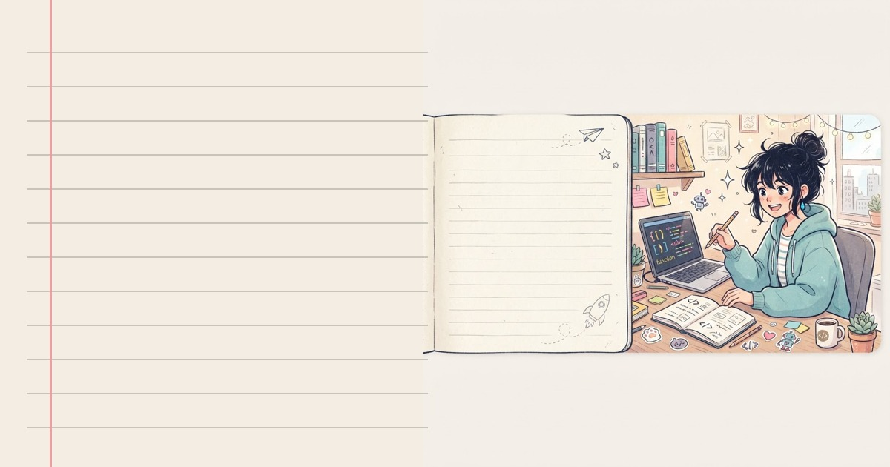

# Hi, I'm Aomi 👋

**A girl in love with the web.** From polishing pixel-perfect UI, crafting backend logic, to keeping databases & APIs alive for everyone.

---

## 💻 Languages I Speak

## 🎨 Frontend

## ⚙️ Backend & Database

## 🧰 Tools

---

## 📊 GitHub Stats

 

---

## 🐍 Contribution Snake

<picture>
  <source media="(prefers-color-scheme: dark)" srcset="https://raw.githubusercontent.com/AomiXplorer/AomiXplorer/output/github-contribution-grid-snake-dark.svg" />
  <source media="(prefers-color-scheme: light)" srcset="https://raw.githubusercontent.com/AomiXplorer/AomiXplorer/output/github-contribution-grid-snake.svg" />
  
</picture>

---

## 🔥 Featured Project

### [Cyronime REST API](https://cyronime.my.id)

197 free public API endpoints — AI, downloaders, search, anime, primbon, canvas & tools. Docs styled like a hand-drawn notebook, complete with a live Try API playground.

---

## 📬 Contact

---

<em>"Good code is like neat handwriting in a notebook — easy to read, nice to use." ✦</em>

