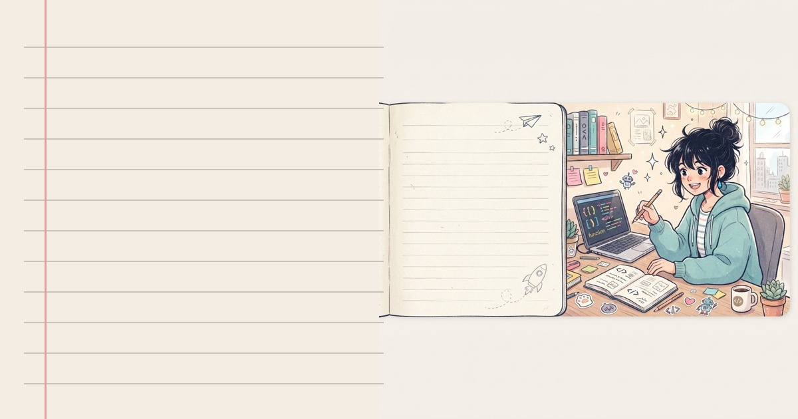

  

### Aomi

Web developer. I build front ends, the APIs behind them, and small tools that explain how things work.

 
The setup: Linux Mint on the laptop, Termux on the phone.

## About

I like the part before the code: opening a product, clicking through it, and working out why it
was built the way it was. Most of what I publish started there, then turned into an API, an app,
or a rewrite.

TypeScript and Next.js most days, Kotlin when it should be an app, Python when the job is a tool
that has to run anywhere and cannot ask for anything first.

Currently building [aomi](https://github.com/AomiXplorer/aomi), a skill for AI agents that keeps
engineering and design in one loop, and maintaining [Cyronime](https://cyronime.my.id), a public
API that began as a shortcut for my own apps.

## Tech Stack

**Languages** 
TypeScript · JavaScript · Kotlin · Python

**Frontend** 
React 19 · Next.js 15 App Router · Tailwind CSS · HTML and CSS

**Backend and APIs** 
Route handlers · public API design · JSON tooling · scraping and reverse-engineered endpoints

**Tools** 
Git · GitHub Actions · Linux Mint · Termux · pipx

**Interested in** 
Reverse engineering · AI tooling · UI engineering · design systems

## Featured Projects

| Project | What it is | Stack |
| --- | --- | --- |
| **[aomi](https://github.com/AomiXplorer/aomi)** | A skill for AI agents that keeps engineering and design in one loop, with a design bar a model cannot quietly skip. Standard-library Python CLI: `init`, `audit`, `contrast`, `parity`, `doctor`. | Python |
| **[Cyronime API](https://github.com/AomiXplorer/rest-api)** · [docs](https://cyronime.my.id) | 197 free endpoints for AI, downloaders, search, anime and canvas work, with a documentation site and a live playground. | Next.js 15 · React 19 · TypeScript |
| **[ShinStream](https://github.com/AomiXplorer/Kamael)** | Anime and donghua streaming client on the Next.js App Router. | Next.js 15 · React 19 |
| **[Cyronime for Android](https://github.com/AomiXplorer/Cyronime-Android)** | Native client for the same API, built to feel like a phone app rather than a wrapped site. | Kotlin |
| **[The World Beyond Your Eyes](https://github.com/AomiXplorer/the-world-beyond-your-eyes)** | An anime visual novel that runs in the browser. | JavaScript |

## Milestones

- **Nov 2026** — aomi 1.1.0 ships: two ways to install it (pipx, or `python3 install.py` with no pip at all), 89 tests, and its own source-available licence.
- **Oct 2026** — the Cyronime API reaches 197 documented endpoints and gets a public documentation site.
- **2026** — 12 public repositories, across web, Android and developer tooling.
- **Mar 2022** — this account starts. Same account, still building.

GitHub's own achievements live on the profile's badge shelf, not in this file. These are milestones
I can point at inside the repositories themselves.

## Contributions

<picture>
  <source media="(prefers-color-scheme: dark)" srcset="https://raw.githubusercontent.com/AomiXplorer/AomiXplorer/output/github-contribution-grid-snake-dark.svg" />
  <source media="(prefers-color-scheme: light)" srcset="https://raw.githubusercontent.com/AomiXplorer/AomiXplorer/output/github-contribution-grid-snake.svg" />
  
</picture>

Two different things, worth keeping apart:

- [The real contribution graph](https://github.com/AomiXplorer) is GitHub's own record of commits, issues and reviews. It turns green when work happens and stays pale when it does not, and nothing in a README can change that.
- The snake is a drawing, not a record. A workflow in this repository rebuilds it every night from that same public data, using GitHub's own greens. It creates no commits and proves no activity: a quiet day simply leaves the snake with nothing to eat.

## Connect

- GitHub — [@AomiXplorer](https://github.com/AomiXplorer)
- Site — [cyronime.my.id](https://cyronime.my.id)
- WhatsApp — [wa.me/6281249578370](https://wa.me/6281249578370)

<em>Good code is like neat handwriting in a notebook — easy to read, nice to use.</em>

