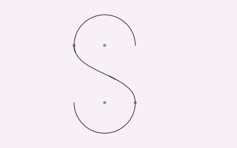
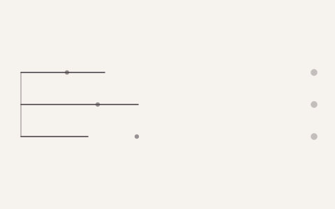
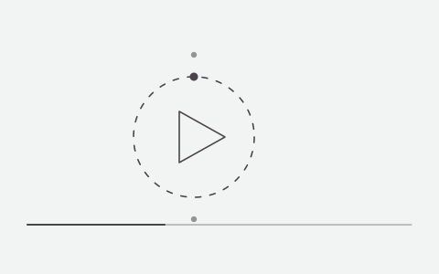
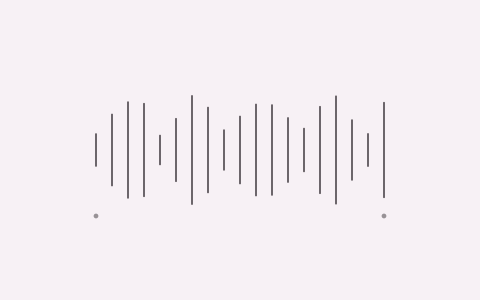

  

### aomi

Reverse Engineering · AI Tools · Software Development

<a href="https://github.com/AomiXplorer">GitHub</a> &nbsp;·&nbsp; <a href="https://github.com/AomiXplorer/aomi">aomi</a> &nbsp;·&nbsp; <a href="https://cyronime.my.id">Cyronime API</a>

## About

<table>
<tr>
<td valign="top">

I take software apart to understand it, then rebuild it until I can explain every line: front ends, the APIs behind them, and the small tools in between. Reverse engineering, AI-assisted development, UI engineering, and the unglamorous parts of shipping.

**Languages** &nbsp;TypeScript&nbsp;&nbsp;&nbsp;&nbsp;JavaScript&nbsp;&nbsp;&nbsp;&nbsp;Kotlin&nbsp;&nbsp;&nbsp;&nbsp;Python&nbsp;&nbsp;&nbsp;&nbsp;HTML/CSS

**Frontend** &nbsp;React&nbsp;&nbsp;&nbsp;&nbsp;Next.js&nbsp;&nbsp;&nbsp;&nbsp;Tailwind&nbsp;&nbsp;&nbsp;&nbsp;Vite&nbsp;&nbsp;&nbsp;&nbsp;Compose&nbsp;&nbsp;Zustand · TanStack · Dexie

**Backend** Route handlers · REST · protobuf / InnerTube · WebCodecs

**Environment** &nbsp;Git&nbsp;&nbsp;&nbsp;&nbsp;Actions&nbsp;&nbsp;&nbsp;&nbsp;Linux Mint&nbsp;&nbsp;&nbsp;&nbsp;Bash&nbsp;&nbsp;&nbsp;&nbsp;Vercel&nbsp;&nbsp;pipx

</td>
<td width="230" valign="top">

</td>
</tr>
</table>

## Projects

<table>
<tr>
<td width="50%" valign="top"> <strong><a href="https://github.com/AomiXplorer/aomi">aomi</a></strong> One skill that holds an agent to both bars: engineering recon first, then a design gate it cannot skip. Python · 89 tests</td>
<td width="50%" valign="top"> <strong><a href="https://github.com/AomiXplorer/rest-api">Cyronime API</a></strong> 197 free endpoints for AI, downloaders, search and canvas work, with docs and a live playground. Next.js · TypeScript</td>
</tr>
<tr>
<td width="50%" valign="top"> <strong><a href="https://github.com/AomiXplorer/freetube">Freetube</a></strong> Installable YouTube client on InnerTube: no API key, history stays on the device. Next.js · React · PWA</td>
<td width="50%" valign="top"> <strong><a href="https://github.com/AomiXplorer/bratgen">bratgen</a></strong> Lyric-video studio in the browser: Whisper sync in a worker, canvas preview, MP4 export. Vite · React · WebCodecs</td>
</tr>
</table>

Also on GitHub: ShinStream, Cyronime for Android, a visual novel, and a few smaller experiments.

## Milestones

## Contributions

<picture>
  <source media="(prefers-color-scheme: dark)" srcset="https://raw.githubusercontent.com/AomiXplorer/AomiXplorer/output/github-contribution-grid-snake-dark.svg" />
  <source media="(prefers-color-scheme: light)" srcset="https://raw.githubusercontent.com/AomiXplorer/AomiXplorer/output/github-contribution-grid-snake.svg" />
  
</picture>

The grid is GitHub's own record of commits, issues and reviews. The snake is a drawing, rebuilt nightly from that same data in GitHub's greens. It adds no commits and proves no activity.

<a href="https://github.com/AomiXplorer">GitHub</a> &nbsp;·&nbsp; <a href="https://cyronime.my.id">cyronime.my.id</a> &nbsp;·&nbsp; <a href="https://wa.me/6281249578370">WhatsApp</a>

<em>Good code is like neat handwriting in a notebook — easy to read, nice to use.</em>

