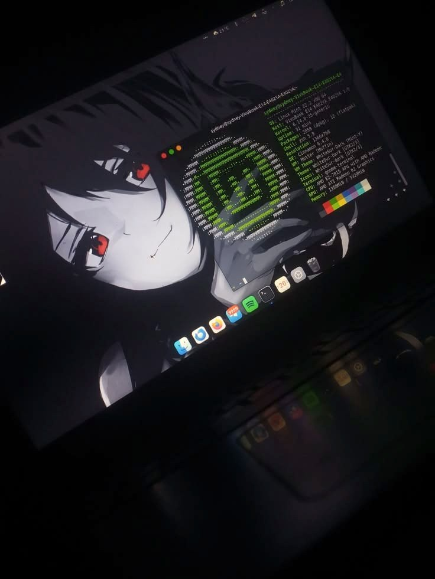
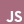
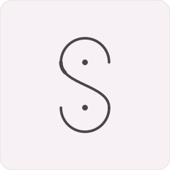
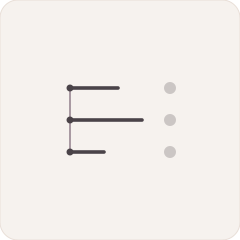
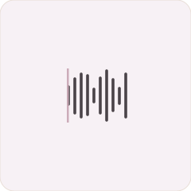

  <picture>
    <source media="(max-width: 600px)" srcset="assets/hero-mobile.svg">
    <source media="(min-width: 601px)" srcset="assets/hero-wide.svg">
    
  </picture>

### aomi

Reverse Engineering · AI Tools · Software Development

<a href="https://github.com/AomiXplorer">GitHub</a> &nbsp;·&nbsp; <a href="https://github.com/AomiXplorer/aomi">aomi</a> &nbsp;·&nbsp; <a href="https://cyronime.my.id">Cyronime API</a>

I take software apart to understand it, then rebuild it until I can explain every line: front ends, the APIs behind them, and the small tools in between. Reverse engineering, AI-assisted development, UI engineering, and the unglamorous parts of shipping.

## Stack

**Languages** &nbsp;TypeScript&nbsp;&nbsp;&nbsp;&nbsp;JavaScript&nbsp;&nbsp;&nbsp;&nbsp;Kotlin&nbsp;&nbsp;&nbsp;&nbsp;Python&nbsp;&nbsp;&nbsp;&nbsp;HTML/CSS

**Frontend** &nbsp;React&nbsp;&nbsp;&nbsp;&nbsp;Next.js&nbsp;&nbsp;&nbsp;&nbsp;Tailwind&nbsp;&nbsp;&nbsp;&nbsp;Vite&nbsp;&nbsp;&nbsp;&nbsp;Compose &nbsp;&nbsp;Zustand · TanStack · Dexie

**Backend** Route handlers · REST · protobuf / InnerTube · WebCodecs

**Environment** &nbsp;Git&nbsp;&nbsp;&nbsp;&nbsp;Actions&nbsp;&nbsp;&nbsp;&nbsp;Linux Mint&nbsp;&nbsp;&nbsp;&nbsp;Bash&nbsp;&nbsp;&nbsp;&nbsp;Vercel &nbsp;&nbsp;pipx

## Projects

-  **[aomi](https://github.com/AomiXplorer/aomi)** Holds an agent to both bars: engineering recon first, then a design gate it cannot skip. Python · 89 tests
-  **[Cyronime API](https://github.com/AomiXplorer/rest-api)** 197 free endpoints for AI, downloaders, search and canvas work, with a live playground. Next.js · TypeScript
-  **[Freetube](https://github.com/AomiXplorer/freetube)** Installable YouTube client on InnerTube, no API key, history stays on the device. Next.js · React · PWA
-  **[bratgen](https://github.com/AomiXplorer/bratgen)** Lyric-video studio in the browser, Whisper sync in a worker, MP4 export. Vite · React · WebCodecs

Also on GitHub: ShinStream, Cyronime for Android, a visual novel, a few smaller experiments.

## Milestones

- **Nov 2026** aomi 1.1.0: 89 tests, installs without pip or network
- **Nov 2026** Freetube: installable PWA on InnerTube, no API key
- **Oct 2026** Cyronime API: 197 documented endpoints, live playground
- **Mar 2022** this account: 12 public repositories since then

GitHub's own achievement badges live on the profile sidebar. Nothing here imitates one.

## Activity

<picture>
  <source media="(prefers-color-scheme: dark)" srcset="https://raw.githubusercontent.com/AomiXplorer/AomiXplorer/output/github-contribution-grid-snake-dark.svg" />
  <source media="(prefers-color-scheme: light)" srcset="https://raw.githubusercontent.com/AomiXplorer/AomiXplorer/output/github-contribution-grid-snake.svg" />
  
</picture>

The grid is GitHub's own record of commits, issues and reviews. The snake is a drawing, rebuilt nightly from that same data in GitHub's greens. It adds no commits and proves no activity.

<a href="https://github.com/AomiXplorer">GitHub</a> &nbsp;·&nbsp; <a href="https://cyronime.my.id">cyronime.my.id</a> &nbsp;·&nbsp; <a href="https://wa.me/6281249578370">WhatsApp</a>

<em>Good code is like neat handwriting in a notebook — easy to read, nice to use.</em>

