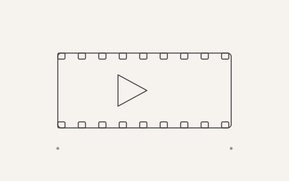
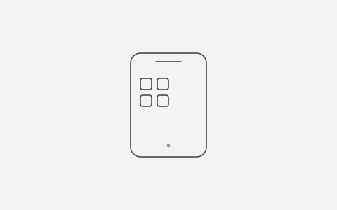

  

### aomi

Reverse Engineering · AI Tools · Software Development

<a href="https://github.com/AomiXplorer">GitHub</a> &nbsp;·&nbsp; <a href="https://github.com/AomiXplorer/aomi">aomi</a> &nbsp;·&nbsp; <a href="https://cyronime.my.id">Cyronime API</a>

## About

<table>
<tr>
<td valign="top">

Software developer, mostly self-directed: front ends, the APIs behind them, and the small tools that make the two meet. Most of my work starts by taking something apart, one request in the network tab at a time, then rebuilding it until I can explain every piece. The repositories below are what came out of that habit.

I like reverse engineering, AI-assisted development, UI engineering, and the unglamorous parts of shipping: tests that actually run, contrast that passes, a layout that holds at 390px.

</td>
<td width="250" valign="top">

 
Linux Mint on the laptop, Termux on the phone.
</td>
</tr>
</table>

## Tech Stack

**Languages** &nbsp;TypeScript&nbsp;&nbsp;&nbsp;&nbsp;JavaScript&nbsp;&nbsp;&nbsp;&nbsp;Kotlin&nbsp;&nbsp;&nbsp;&nbsp;Python&nbsp;&nbsp;&nbsp;&nbsp;HTML/CSS

**Frontend** &nbsp;React&nbsp;&nbsp;&nbsp;&nbsp;Next.js&nbsp;&nbsp;&nbsp;&nbsp;Tailwind&nbsp;&nbsp;&nbsp;&nbsp;Vite&nbsp;&nbsp;&nbsp;&nbsp;Compose&nbsp;&nbsp;&nbsp;Zustand · TanStack Query · Dexie

**Backend &amp; data** Route handlers · REST API design · protobuf / InnerTube · WebCodecs · Service Workers · IndexedDB

**Tools &amp; environment** &nbsp;Git&nbsp;&nbsp;&nbsp;&nbsp;Actions&nbsp;&nbsp;&nbsp;&nbsp;Linux Mint&nbsp;&nbsp;&nbsp;&nbsp;Bash / Termux&nbsp;&nbsp;&nbsp;&nbsp;Vercel&nbsp;&nbsp;&nbsp;pipx

## Featured Projects

<table>
<tr>
<td width="180" valign="top"></td>
<td valign="top"><strong><a href="https://github.com/AomiXplorer/aomi">aomi</a></strong> One skill for AI agents that keeps engineering and design in one loop: recon, architecture, then a design bar it refuses to skip. Standard-library Python, no dependencies. Python · CLI · 89 tests</td>
</tr>
<tr>
<td width="180" valign="top"></td>
<td valign="top"><strong><a href="https://github.com/AomiXplorer/rest-api">Cyronime API</a></strong> 197 free endpoints for AI, downloaders, search, anime and canvas work, with a documentation site and a live playground. Next.js 15 · React 19 · TypeScript</td>
</tr>
<tr>
<td width="180" valign="top"></td>
<td valign="top"><strong><a href="https://github.com/AomiXplorer/freetube">Freetube</a></strong> Installable YouTube client on InnerTube: no official API key, no database, and watch history that never leaves IndexedDB. Next.js 15 · React 19 · PWA</td>
</tr>
<tr>
<td width="180" valign="top"></td>
<td valign="top"><strong><a href="https://github.com/AomiXplorer/bratgen">bratgen</a></strong> Lyric-video studio that runs entirely in the browser: Whisper auto-sync in a worker, canvas preview, MP4 export through WebCodecs. Vite · React · TypeScript · WebCodecs</td>
</tr>
<tr>
<td width="180" valign="top"></td>
<td valign="top"><strong><a href="https://github.com/AomiXplorer/Kamael">ShinStream</a></strong> Anime and donghua streaming client on the App Router, built to be deployed rather than wrapped. Next.js 15 · React 19 · App Router</td>
</tr>
<tr>
<td width="180" valign="top"></td>
<td valign="top"><strong><a href="https://github.com/AomiXplorer/Cyronime-Android">Cyronime for Android</a></strong> Native Kotlin client for the same API, so the phone version is an application and not a website in a shell. Kotlin · Jetpack Compose</td>
</tr>
</table>

## Achievements &amp; Milestones

Two kinds of credit, kept apart on purpose. The badges GitHub hands out live on the profile sidebar, next to the avatar, and nothing here imitates one. What sits above are releases and repository facts I can point at in the code.

## Contributions

<picture>
  <source media="(prefers-color-scheme: dark)" srcset="https://raw.githubusercontent.com/AomiXplorer/AomiXplorer/output/github-contribution-grid-snake-dark.svg" />
  <source media="(prefers-color-scheme: light)" srcset="https://raw.githubusercontent.com/AomiXplorer/AomiXplorer/output/github-contribution-grid-snake.svg" />
  
</picture>

- [The contribution graph](https://github.com/AomiXplorer) is GitHub's record of commits, issues and reviews. It turns green when work happens and stays pale when it does not. Nothing in a README can change that, and I do not generate commits to paint it.
- The snake is a drawing. A workflow in this repository rebuilds it every night from that same public data, in GitHub's own greens. It adds no commits and proves no activity: a quiet day leaves it with nothing to eat.

## Contact

<a href="https://github.com/AomiXplorer">GitHub</a> &nbsp;·&nbsp; <a href="https://cyronime.my.id">cyronime.my.id</a> &nbsp;·&nbsp; <a href="https://wa.me/6281249578370">WhatsApp</a>

<em>Good code is like neat handwriting in a notebook — easy to read, nice to use.</em>

